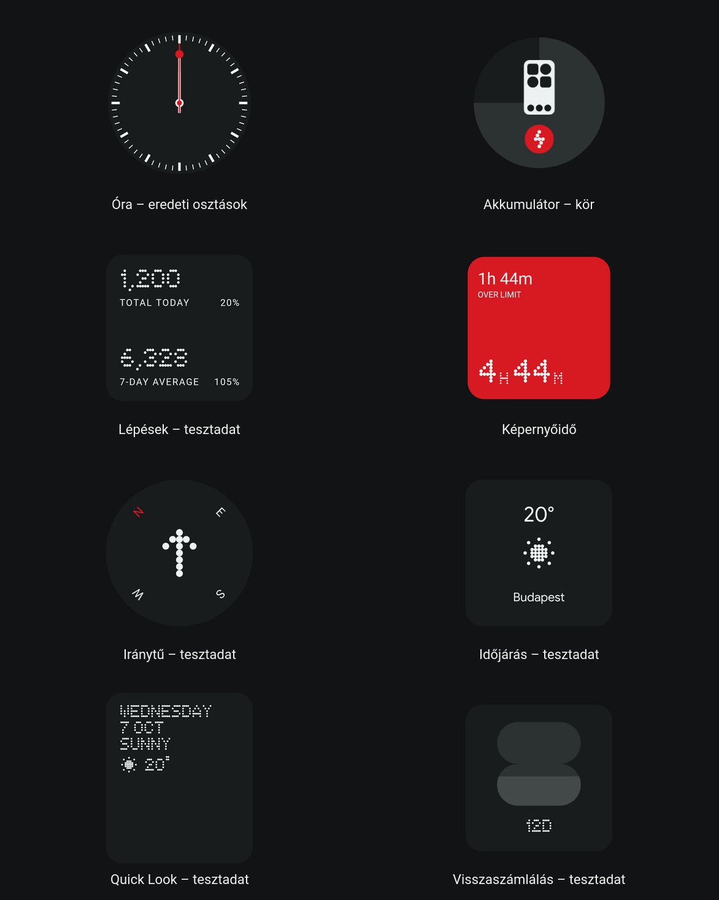

# NothingWidgetPort

NothingWidget is a native Android port of 31 Nothing-style widgets for standard launchers. It uses original artwork and dot fonts, with local data for steps, screen time, photos, and media. Weather uses Open-Meteo.

This is an independent port. It has no AI widget generation, community feed, or Nothing account login.

[Download the APK](https://github.com/damjankakak3/NothingWidgetPort/releases/latest) · [Report a bug](https://github.com/damjankakak3/NothingWidgetPort/issues)



These are Android widget-host renders. Some previews use test data; the labels are in Hungarian.

## Install

1. Download `NothingWidget-0.3.2.apk` from the releases page and install it.
2. Open NothingWidget and choose a widget to preview or set up.
3. Add it from the app or your launcher's widget picker. Grant permissions for the features you use.

The app targets Android 16 and declares Android 12 as its minimum version. It has been tested on a Xiaomi 12 Pro running Evolution X Android 16 with Pixel Launcher. Other phones and launchers have not been verified.

Root is not required by the app. Native clock and date text uses Nothing font families supplied by the ROM. If those families are missing, Android falls back to a system font. Static widget artwork uses the fonts bundled in the APK. The app does not install system fonts.

The package ID is `dev.dipa.widgets`. Release builds use the same signing certificate as the earlier Local Widgets app, so you can install this as an update and keep your settings and placed widgets.

## Widgets

| Family | Variants |
| --- | --- |
| Clocks | Two analog styles, stacked digital, wide digital, world clock |
| Date and Quick Look | Date, transparent Quick Look, card Quick Look |
| Photos | Circle, rectangle |
| Compass | Standard, small |
| Steps | Today and average, goal progress, daily count, weekly streak |
| Screen time | Total, duration, usage shape, face |
| Media | Album artwork and playback controls |
| Battery | Connected devices, phone |
| Countdown | Date countdown |
| Breathing | Relax, Focus, Calm |
| Weather | Circle, square, forecast, combo |

## How they work

Widgets fit the sizes reported by the launcher. Circular designs stay square inside their slot, and artwork keeps its aspect ratio. Native Android clock views handle the ticking; the app does not redraw clock bitmaps in a background loop.

Steps use the hardware counter with 30-second sensor batching and a persistent notification. Tracking starts when you enable it; resume it from setup after a reboot. Screen time uses Android's screen-interactive events, so its totals can differ from Digital Wellbeing. Media controls use active media sessions through notification access.

Photos support up to 16 images selected with Android's file picker. Tap to switch images or world-clock pages. Tap a compass widget once to enable live home-screen readings, or select "Start live widgets" in setup. A persistent notification lets you stop sensing. Sensors pause while the phone is locked or its screen is off, and the widget redraws at most once per second when the heading changes. The arrow represents the top of your phone; the north marker rotates around it.

Breathing opens a session with simplified animation. Device batteries use Android's existing cache and connection broadcasts, including reports received before permission was granted. Some ROMs block the cache getter; reconnecting the device supplies a new report there.

Weather sends your selected city to Open-Meteo's geocoding and forecast services. A persistent hourly job refreshes the cache, and stale data queues a catch-up job. Android may delay background jobs while the device is idle or offline. Calendar widgets need calendar access. Other widget data stays on the device. The port does not load Nothing's original executable code, CardService, or analytics.

Some Nothing OS animations and integrations are simplified. Battery use has not been benchmarked against the original app.

## Build

You need a JDK 17 or newer, Python 3, and the Android SDK with platform 36 and build tools 35.0.0. The build uses SDK command-line tools directly; it does not use Gradle.

```bash
git clone https://github.com/damjankakak3/NothingWidgetPort.git
cd NothingWidgetPort
export ANDROID_SDK_ROOT="$HOME/Android/Sdk"
bash tools/build.sh
```

The APK is written to `artifacts/NothingWidget-0.3.2.apk`, alongside `SHA256SUMS`. Checked-in resources make the repo buildable without downloading the firmware. `tools/prepare_app.py` is an optional importer for a local decoded donor workspace.

On the first build, the script generates a local signing key in `source/local-widgets.keystore`. Keep that key if you want to update your own builds. A locally generated key cannot update the published APK. To use an existing key, set `KEYSTORE_PATH`, `KEYSTORE_ALIAS`, and `KEYSTORE_PASSWORD`. Private keys and build output are ignored by Git.

## Tests and bug reports

The build runs date and counter logic checks and verifies APK signing and alignment. The renderer passed 578 checks on the Android 16 target phone in the 0.3.0 baseline and again in the 0.3.2 emulator run: 286 host layouts, 112 battery states, 84 compass states, and 96 populated fixtures. An isolated emulator also rendered 120 references using the original Nothing APK's views. These checks cover layout and rendering; they do not establish full Nothing OS parity.

The 0.3.2 runtime checks also exercise real weather job dispatch, preserving the periodic schedule across repeated updates, compass widget callbacks and screen-off suspension, and Bluetooth report handling. The Android 16 emulator passed 29 runtime checks. See [validation instructions](docs/validation.md) to run them.

For a visual bug, include your phone, Android version, launcher, widget variant, grid size, and a screenshot. Font and sizing problems can depend on the host, so those details help reproduce them.

## Credits

The visual reference is NothingCardLab 3.4.2 and Nothing Weather 3.1.7 from the official Phone (3) firmware `Metroid_B4.1-260814-1733`. [Asset provenance](docs/assets.md) records the donor and imported resources.

Nothing's names, artwork, and fonts belong to their respective owners. This project is not affiliated with Nothing. Weather data comes from [Open-Meteo](https://open-meteo.com/).
